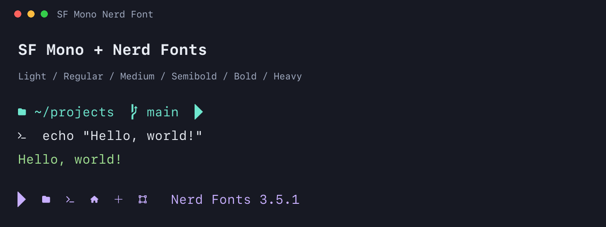

# SF Mono Nerd Font

Apple's SF Mono with [Nerd Fonts](https://www.nerdfonts.com/) icons. The familiar macOS terminal font, with Powerline symbols, file icons and the rest of the Nerd Fonts collection.



## Installation

### Manual

1. [Download the fonts](https://github.com/IvanNovR/sf-mono-nerd-font/archive/refs/tags/v1.0.0.zip) and unzip the archive.
2. Open the `.otf` files in **Font Book** and click **Install**.

### Homebrew

```sh
brew tap IvanNovR/ivannovr
brew install --cask IvanNovR/ivannovr/font-sf-mono-nerd-font
```

### Use the font

After installation, choose **SF Mono Nerd Font** in your terminal's font settings.

For example, in Apple Terminal on macOS, go to **Settings → Profiles → Text → Font**.

## What's included

Six weights — **Light, Regular, Medium, Semibold, Bold and Heavy** — each with italics. All icons fit in a single terminal cell.

For a typical terminal setup, install Regular, Bold, Italic and Bold Italic. You can also install all 12 fonts to have every weight available.

Patched with the official Nerd Fonts patcher **v3.5.1**.

## Credits

SF Mono is by Apple. The icons and patcher come from [Nerd Fonts](https://github.com/ryanoasis/nerd-fonts).

This is an unofficial project. SF Mono remains proprietary; this repository does not grant additional rights to Apple's fonts. See [license notices](LICENSE.md).
